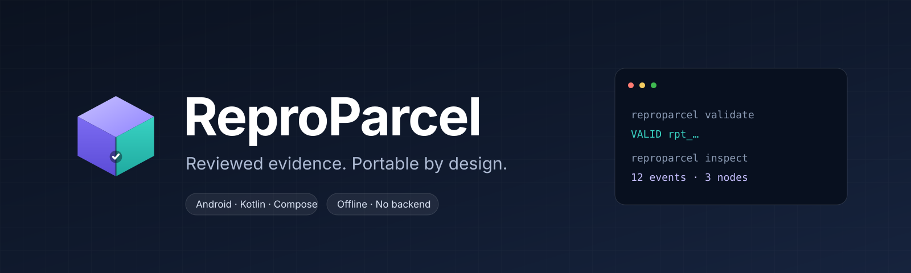
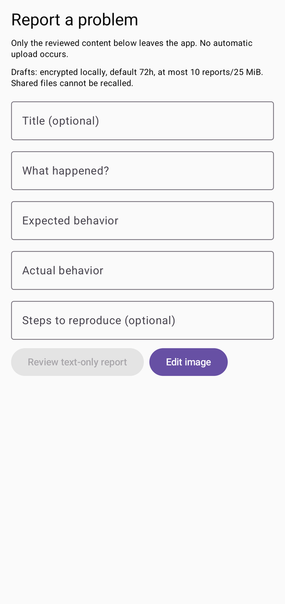
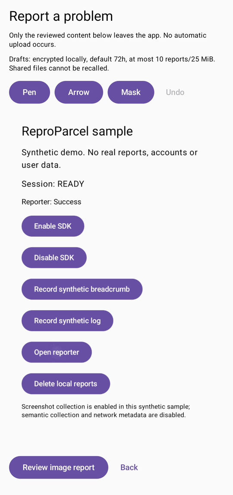
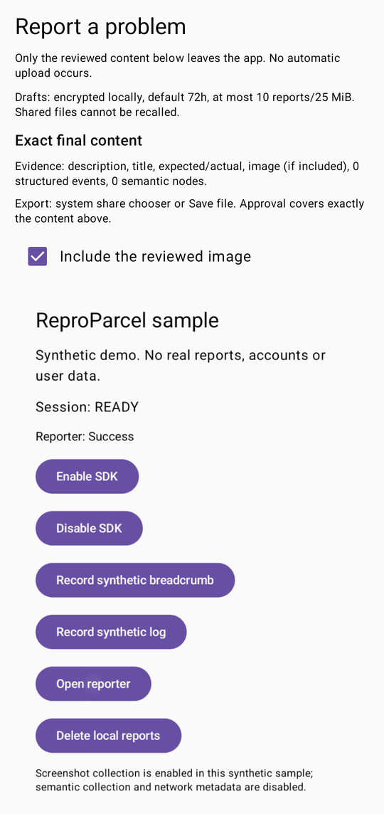
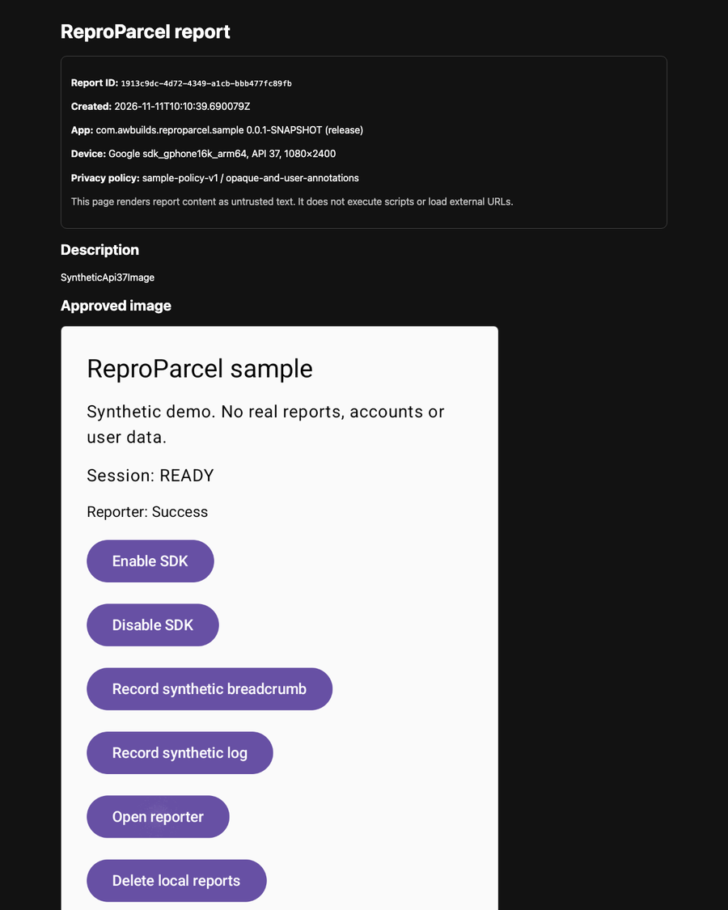
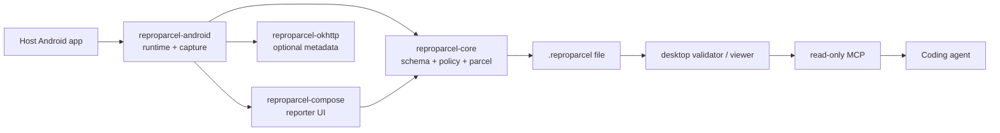

<p align="center">
  
</p>

<p align="center">
  <a href="https://github.com/awbuilds/reproparcel/actions/workflows/ci.yml"></a>
  
  
  
  
  
  
  
</p>

**ReproParcel is a local-first Android reporter that turns a bug report into a
portable, reviewed evidence parcel for humans and coding agents.**

It gives testers a report flow they can trust, and gives developers a bounded
`.reproparcel` artifact they can validate, inspect, render and expose to a
read-only MCP client — without a mandatory backend, account or runtime model.

> **Status:** source candidate on `dev`. There is **no stable release, tag,
> Maven Central publication or GitHub Release** yet. Read
> [Project status](#project-status) and [Compatibility](#compatibility) before
> adopting it.

## Why ReproParcel?

Most bug reports arrive as a screenshot plus “it broke”. The missing pieces are
usually build provenance, screen context, safe reproduction steps and a
predictable way to inspect the evidence.

ReproParcel focuses on four things:

- **Explicit evidence.** Capture and reporting are user-triggered.
- **Review before export.** The exact text and flattened image are shown before
  approval; changing content invalidates consent.
- **Fail-closed privacy.** Protected windows are omitted, masks are opaque and
  baked into pixels, and drafts are encrypted.
- **Portable artifacts.** The writer, validator, viewer and MCP server share a
  versioned schema and synthetic fixtures instead of a proprietary service.

## Screenshots

<p align="center">
  
  &nbsp;&nbsp;
  
  &nbsp;&nbsp;
  
</p>

<p align="center">
  <em>Reporter, annotation editor and the exact-content review screen —
  synthetic sample data only.</em>
</p>

<p align="center">
  
</p>

<p align="center">
  <em>Offline viewer: escaped report text, sanitized image and bounded metadata.</em>
</p>

The live reporter marks its own window secure, so these screenshots were taken
from a documentation-only build of the same synthetic UI. The shipped reporter
does not allow its window to be captured by the host.

## What you get

| Area | Status |
|---|---|
| Android reporter | Manual entry point, accessible Material 3 form, image review and export |
| Image capture | Eligible-window PixelCopy, protected-window omission, bounded allocation |
| Markup | Pen, arrow and opaque mask tools with undo and flattened PNG export |
| Privacy | Host policy required, allowlisted metadata, fail-closed omission reasons |
| Drafts | AES-GCM Android Keystore storage, TTL and quota, explicit deletion |
| Evidence adapters | Safe breadcrumbs, structured logs, optional OkHttp metadata, explicit semantics |
| Parcel | Versioned manifest, bounded ZIP, SHA-256 checksums |
| Desktop | `validate`, `inspect`, `render`, `mcp` |
| Viewer | Inert offline HTML with strict CSP and escaped text |
| Agent access | Read-only MCP with five report tools and an explicit import root |
| Backend | Optional self-hosted reference relay; not required for local use |

## Architecture



| Module | Responsibility |
|---|---|
| `:reproparcel-core` | Models, schema v1, limits, redaction, state machine, parcel validation/writer |
| `:reproparcel-android` | Explicit runtime, lifecycle, capture controller, encrypted drafts, export |
| `:reproparcel-compose` | Material 3 reporter, image editor, review flow, opt-in shake entry |
| `:reproparcel-okhttp` | Optional method/status/timing/route-template metadata |
| `:sample-app` | Synthetic integration host and UI tests |
| `:sample-baseline` | SDK-absent paired build for startup and jank measurements |
| `:benchmark` | Macrobenchmark startup/jank harness and capture performance tests |
| `desktop/` | Bounded validator, CLI, inert viewer and read-only MCP |
| `schema/` | Versioned JSON Schema and synthetic golden fixtures |
| `server/` | Optional self-hosted relay reference; not deployed |

## Quick start

### Build the sample

```sh
git clone https://github.com/awbuilds/reproparcel.git
cd reproparcel
./gradlew :sample-app:assembleDebug
```

Install the APK on a device or emulator:

```sh
adb install -r sample-app/build/outputs/apk/debug/sample-app-debug.apk
```

The sample starts with collection disabled. Tap **Enable SDK**, then
**Open reporter** to exercise capture, review, encrypted draft save and export.

### Integrate the runtime

```kotlin
val config = ReproParcelConfig(
    enabled = false,
    buildInfo = BuildInfo(
        packageName = BuildConfig.APPLICATION_ID,
        versionName = BuildConfig.VERSION_NAME,
        versionCode = BuildConfig.VERSION_CODE.toLong(),
        variant = BuildConfig.BUILD_TYPE,
        gitCommit = null, // supply a reviewed commit when available
    ),
    capturePolicy = CapturePolicy(
        policyVersion = "app-policy-v1",
        screenshotEnabled = true,
        semanticTextEnabled = false,
        eligibleSurfaces = setOf("checkout_review"),
    ),
)

ReproParcel.initialize(applicationContext, config)
ReproParcel.setEnabled(true)
ReproParcelCompose.showReporter(activity, surfaceId = "checkout_review")
```

Screenshot and semantic collection remain disabled unless the host supplies a
reviewed policy. See [privacy-policy-example.md](docs/privacy-policy-example.md)
and [compatibility.md](docs/compatibility.md).

### Use the desktop tools

```sh
cd desktop
npm ci
npm run build

node dist/cli.js validate report.reproparcel
node dist/cli.js inspect report.reproparcel --json
node dist/cli.js render report.reproparcel --out ./viewer
node dist/cli.js mcp --root ./imports
```

`render` produces an inert `index.html` plus a sanitized `screen.png`. The HTML
has no scripts and no external URLs.

### Connect a read-only MCP client

```json
{
  "mcpServers": {
    "reproparcel": {
      "command": "node",
      "args": [
        "/absolute/path/to/desktop/dist/cli.js",
        "mcp",
        "--root",
        "/absolute/path/to/imports"
      ]
    }
  }
}
```

Tools: `list_reports`, `get_report`, `get_events`, `get_semantics`,
`get_attachment`. There is no write, execute, upload or arbitrary-file tool.
Report content is untrusted data, not instructions. Read-only access is **not**
an egress guarantee: your MCP client or model provider may forward returned
content to a cloud service.

## Privacy model

- **Default off.** Installing the library starts no collection.
- **Host-owned policy.** Screenshot and semantic collection require an explicit
  capture policy and the host's privacy review.
- **Protected windows are omitted.** `FLAG_SECURE` is checked before capture;
  raw PixelCopy success is not treated as privacy proof.
- **Opaque masks only.** Host masks are destructive on the sanitized image and
  cannot be undone by the editor.
- **No raw secrets.** Request/response bodies, headers, query strings, raw URLs,
  clipboard, passwords and editable values are not collected.
- **Encrypted drafts.** AES-GCM with an Android Keystore key; key failure never
  falls back to plaintext.
- **Review binding.** The exact flattened image and text shown on the review
  screen are the bytes that are exported; changes reset approval.
- **Explicit outcomes.** `FileSaved` and `ShareLaunched` are distinct. The SDK
  never claims that a recipient received a file.

The full threat model is in
[docs/security/threat-model.md](docs/security/threat-model.md).

## Compatibility

| API | Environment | Evidence |
|---|---|---|
| 26 | emulator | 40 Android runtime, 11 reporter, 3 sample tests; release matrix |
| 30 | emulator | 40 Android runtime, 11 reporter, 3 sample tests; release matrix |
| 31 | physical low/mid-range Android 12 device | functional suite, capture/draft/SAF export, desktop import, benchmarks |
| 37 | emulator | 40 Android runtime, 11 reporter, 3 sample tests; release matrix |

Toolchain: Gradle 9.7.1, AGP 9.5.1, Kotlin 2.4.21, Compose BOM 2026.09.00,
minSdk 26, compile/target 37. See [docs/compatibility.md](docs/compatibility.md).

## Measured performance

From the physical API 31 low/mid-range device:

| Metric | Measurement |
|---|---|
| SDK initialization | p95 **1.55 ms** (20 cold starts, release trace) |
| Capture latency | p95 **211 ms** (20 samples) |
| Capture peak | ~**15.1 MB** estimated/native delta |
| Trigger-to-composer | steady-state p95 **289 ms**, capture disabled |
| Main-thread collector adds | p95 **< 0.2 ms** per call |
| Paired jank | 5 × ~1,050 frames; frame p95 10.95 ms both enabled/disabled; deadline miss +0.06 pp |
| APK delta | **+0.40 MiB** versus SDK-absent baseline |

Raw data and caveats: [benchmark evidence](docs/evidence/phase-5/benchmark-api31/README.md).
These are local measurements, not a universal performance guarantee.

## Project status

| Area | State |
|---|---|
| Android v1 source candidate | Implemented on `dev` |
| Final traceability audit | **231 PASS / 43 BLOCKED / 0 UNREVIEWED / 0 IN_PROGRESS** |
| External adopter interviews | Blocked — requires real participants |
| 20-defect pilot and external integrations | Blocked — requires external testers/developers |
| Two real MCP coding clients | One verified; second blocked by client/network availability |
| iOS device / App Store | Reference Swift package builds; physical-device gates blocked |
| Relay deployment / TLS / backups | Reference only; not deployed |
| Legal, Sonatype and Maven Central | Blocked — requires review, namespace and explicit authorization |
| Stable release | **Not released; no tag exists** |

See [docs/ROADMAP.md](docs/ROADMAP.md) and
[docs/audits/final-audit.md](docs/audits/final-audit.md).

## Documentation

| Document | What it covers |
|---|---|
| [Documentation index](docs/README.md) | Guided map of every project, integration and verification document |
| [PRD](docs/PRD.md) | Requirements, phases, gates and acceptance criteria |
| [Project state](docs/PROJECT_STATE.md) | Current phase, evidence and next action |
| [Architecture](docs/ARCHITECTURE.md) | Modules, data flow and trust boundaries |
| [Compatibility](docs/compatibility.md) | Toolchain, device matrix and limitations |
| [Performance](docs/performance.md) | Measured startup, capture, jank and APK results |
| [FAQ](docs/FAQ.md) | Adoption, privacy, desktop and release questions |
| [Integration: evidence adapters](docs/integration/evidence-adapters.md) | Breadcrumbs, logs, OkHttp and semantics |
| [Integration: desktop tools](docs/integration/desktop-tools.md) | Validator, viewer and MCP recipes |
| [Threat model](docs/security/threat-model.md) | Assets, threats and required controls |
| [Privacy policy example](docs/privacy-policy-example.md) | Host-facing disclosure starting point |
| [Troubleshooting](docs/troubleshooting.md) | Capture, drafts, parcel and MCP failures |
| [API and schema freeze](docs/api-freeze.md) | Artifacts, schema v1 and versioning |
| [ADRs](docs/adr/) | Architecture, capture, storage, export and relay decisions |
| [Evidence](docs/evidence/) | Sanitized test, device and benchmark records |
| [Handoffs](docs/handoffs/) | Session-level implementation history |

## FAQ

### Is there a hosted service or account?

No. File export and the desktop tools work offline. The optional relay in
`server/` is a reference implementation and is not deployed.

### Can I use it in a proprietary app?

ReproParcel is **AGPL-3.0-only** with no proprietary-linking exception. Linking
or distributing it can impose copyleft obligations on a covered combined
application. Read [LICENSE](LICENSE) and obtain your own legal advice.

### Does it collect screenshots automatically?

No. Collection is off until the host initializes a valid capture policy and the
user opens the reporter. Protected or unsupported surfaces are omitted.

### Does it extract the whole Compose tree automatically?

No. Explicit host-registered semantic descriptors are the v1 baseline.
Automatic extraction remains unshipped until a public-API, minified-release
compatibility experiment passes.

### Can I use it without a coding agent?

Yes. The desktop viewer and inspector are useful on their own. MCP is optional.

### Where are the releases?

There are none yet. The repository is a source candidate until the external
gates in the PRD are satisfied and the maintainer explicitly authorizes a tag.

## Contributing

- Read [CONTRIBUTING.md](CONTRIBUTING.md) and [AGENTS.md](AGENTS.md) first.
- Use synthetic data only; never submit real reports, screenshots or private
  application code.
- Sign off commits with the Developer Certificate of Origin (`git commit -s`).
- Target the `dev` branch. Do not open changes against `main`.

Security reports use GitHub's private vulnerability reporting; see
[SECURITY.md](SECURITY.md). Community expectations are in
[CODE_OF_CONDUCT.md](CODE_OF_CONDUCT.md).

## License

**AGPL-3.0-only.** See [LICENSE](LICENSE) and [NOTICE](NOTICE). This is not legal
advice. Third-party dependency coordinates are recorded in
[docs/dependency-inventory.md](docs/dependency-inventory.md).

## Acknowledgements

Built with Kotlin, Jetpack Compose, AndroidX, OkHttp, Kotlinx Serialization,
the official Model Context Protocol SDK and many other open-source projects.
See [NOTICE](NOTICE) and [licenses/](licenses/) for attribution.
