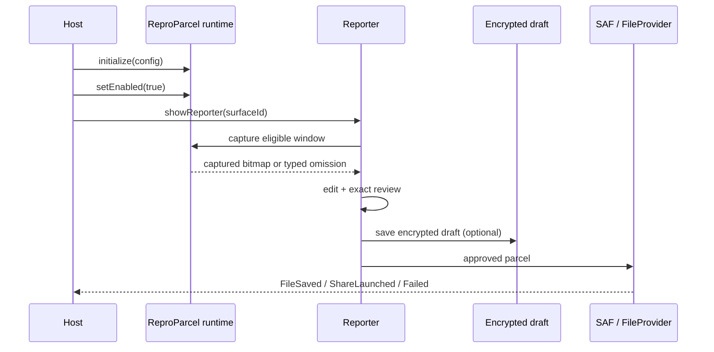

# Architecture

ReproParcel is split so a host can adopt only the pieces it needs, while the
parcel contract remains independent of Android, the UI and any model provider.

## Module graph

```text
:reproparcel-core        Kotlin/JVM
  models, schema v1, limits, redaction, state machine,
  parcel validation/writer, PNG validation

:reproparcel-android     Android library
  explicit runtime, lifecycle, capture, encrypted drafts,
  FileProvider/SAF export, evidence adapters

:reproparcel-compose     Android library
  Material 3 reporter, annotation editor, review flow,
  optional foreground shake entry

:reproparcel-okhttp      Android library
  optional request metadata interceptor

:sample-app              synthetic integration host
:sample-baseline         SDK-absent paired baseline
:benchmark               macrobenchmark + capture performance

desktop/                 Node.js/TypeScript
  bounded validator, CLI, inert viewer, read-only MCP

schema/                  JSON Schema + synthetic fixtures
server/                  optional self-hosted relay reference
```

Dependency direction:

```text
core <- android <- compose
core <- okhttp
core <- sample-app
android + compose -> sample-app
schema/fixtures -> core tests + desktop tests
```

`core` has no Android, Compose, network or model-provider dependency.

## Report lifecycle



The reporter captures eligible host content **before** its own window opens.
The bitmap is handed off in process memory, never through a Bundle, Intent
extra, navigation argument or saved state. Process death loses the image and
the reporter safely starts text-only.

## Trust boundaries

### Host application

The host is trusted to configure policy, but not to bypass it silently. Every
entry point returns a typed outcome. Invalid configuration leaves the runtime
uninitialized; disabling cancels SDK-owned work and clears buffers.

### Report content

All report text, labels, events and attachments are untrusted data. The viewer
escapes text and uses a restrictive CSP. The MCP server returns content as data
and never executes instructions from a report.

### Desktop import

The desktop reader treats the ZIP as hostile:

- path allowlist, traversal and absolute-path rejection;
- symlink, duplicate and unreferenced-entry rejection;
- entry count, compressed/uncompressed size and compression-ratio limits;
- JSON byte/depth/node budgets;
- PNG dimension and decoded-byte budgets before rendering;
- metadata-stripped PNG re-encoding.

### MCP client and model provider

MCP is read-only and accepts report IDs, not arbitrary paths. Read-only access
does not prevent the client or its model provider from sending returned content
to a cloud service. The MCP responses and integration guide warn about this.

## Capture

`CaptureController` is main-thread gated and requires:

- a host capture policy with the current surface eligible;
- an enabled runtime and matching policy generation;
- a non-secure window (`FLAG_SECURE` pre-check);
- a measurable window within the image budget;
- an attempt token bound to window identity, policy version and layout
  generation;
- a bounded 2-second timeout;
- a post-copy re-check of window/policy/generation/secure state.

Masks are opaque and applied destructively to the sanitized bitmap. The editor
starts from that sanitized base; undo cannot restore masked pixels. Raw frames
are never persisted.

## Drafts

```text
noBackupFilesDir/reproparcel/drafts/
  index.json        id, timestamp, encrypted size only
  <id>/report.enc   AES-GCM
  <id>/image.enc    AES-GCM (optional)
```

The key is Android Keystore-backed AES-256-GCM. Writes are atomic and
`fsync`-ed. Key or crypto failure returns a typed failure; there is no plaintext
fallback. Retention defaults to 72 hours, 10 reports and 25 MiB.

## Parcel

A `.reproparcel` file is a bounded ZIP:

```text
manifest.json
report.json
events.json        optional
semantics.json     optional
attachments/screen.png   optional
```

The manifest lists every entry with media type, uncompressed size and SHA-256.
Checksums detect corruption, not authenticity. Schema v1 is described in
[`schema/README.md`](../schema/README.md) and
[ADR 0008](adr/0008-schema-v1-and-compatibility.md).

## Export

- SAF `CreateDocument` is the confirmed local save path.
- Sharing uses a narrow `FileProvider` path with a temporary read grant.
- `FileSaved` and `ShareLaunched` are distinct outcomes.
- A shared file cannot be recalled; the UI states this before approval.
- Export serialization failure never yields a partial parcel.

## Desktop tools

```text
parcel.ts   streaming bounded ZIP/JSON/PNG validation
viewer.ts   escaped, inert HTML + sanitized image
mcp.ts      stdio server, explicit root, report IDs, five read-only tools
cli.ts      validate / inspect / render / mcp
```

The desktop implementation shares the schema and synthetic fixtures with the
Android writer, not runtime classes.

## Error handling

- Recoverable failures are caught at SDK-owned boundaries.
- `CancellationException` is always rethrown.
- Provider exceptions and timeouts become typed results and cannot crash the
  host.
- Privacy failure omits evidence; encryption failure never falls back to
  plaintext; export failure never produces a misleading partial file.
- Fatal VM errors, native signals and out-of-memory errors are not swallowed.

## Related decisions

- [ADR 0001 — module architecture](adr/0001-module-architecture.md)
- [ADR 0002 — capture and temporal privacy](adr/0002-capture-feasibility-and-temporal-privacy.md)
- [ADR 0003 — semantics strategy](adr/0003-semantics-strategy.md)
- [ADR 0010 — encrypted drafts](adr/0010-encrypted-draft-storage.md)
- [ADR 0011 — export outcomes](adr/0011-export-share-outcomes.md)
- [ADR 0013 — offline reader/viewer/MCP](adr/0013-offline-reader-viewer-mcp.md)
- [ADR 0014 — optional relay](adr/0014-self-hosted-write-only-relay.md)
